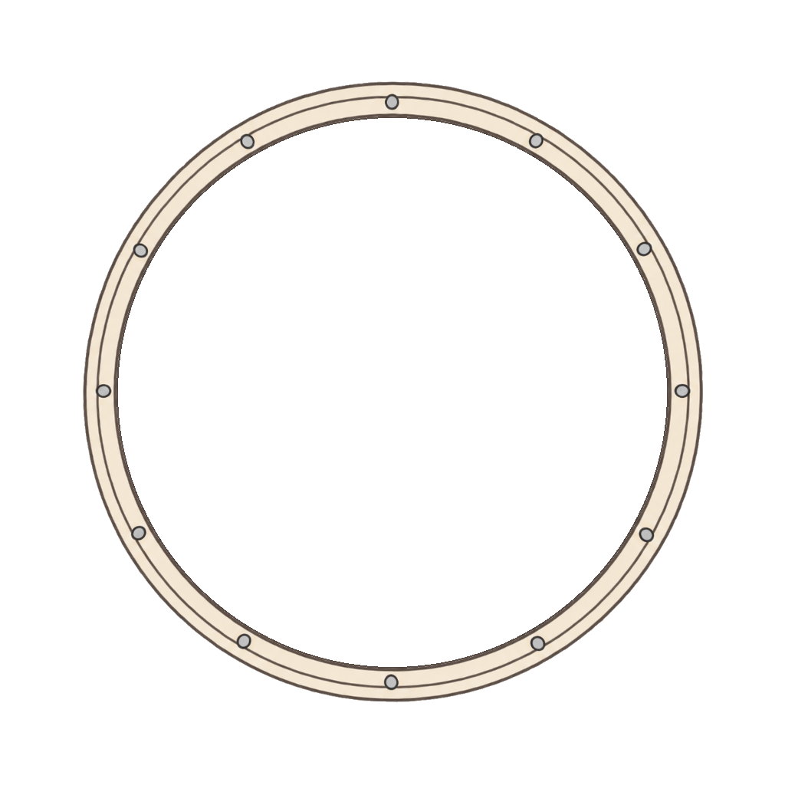

# 프로필 장식 테두리 100종

과도한 금속 반사광과 입체 렌더링을 줄인 평면 일러스트 에셋입니다.
각 디자인은 압축 묶음 없이 **개별 RGBA PNG**로 저장했습니다.

| 등급 | 폴더 | 번호 | 수량 |
|---|---|---|---:|
| 일반 | [normal](assets/profile-borders/normal) | 001–030 | 30 |
| 고급 | [premium](assets/profile-borders/premium) | 031–055 | 25 |
| 희귀 | [rare](assets/profile-borders/rare) | 056–075 | 20 |
| 영웅 | [epic](assets/profile-borders/epic) | 076–090 | 15 |
| 전설 | [legendary](assets/profile-borders/legendary) | 091–100 | 10 |

## 공통 규격

- 크기: 1024×1024px, PNG RGBA
- 중심: (512, 512)
- 실제 테두리 안쪽 원: 지름 716px (반지름 358px)
- 중앙 원 내부: 모든 픽셀의 알파값 0
- 모든 디자인의 안쪽 2px 윤곽을 동일한 원에 맞춤
- 장식 바깥쪽 안전 반경: 480px, 캔버스 가장자리 여백 최소 32px
- 이름·등급·파일 경로·검사 결과·SHA-256: [manifest.json](assets/profile-borders/manifest.json)

## 적용 예시

프로필 사진의 원 지름을 전체 장식 이미지 너비의 69.921875%로 맞춥니다.

```html
<div class="profile">
  
  
</div>
```

```css
.profile { position: relative; width: 128px; aspect-ratio: 1; }
.avatar {
  position: absolute; width: 69.921875%; height: 69.921875%;
  left: 15.0390625%; top: 15.0390625%; object-fit: cover; border-radius: 50%;
}
.frame { position: absolute; inset: 0; width: 100%; height: 100%; pointer-events: none; }
```

## 미리보기와 검증

[미리보기 HTML](assets/profile-borders/index.html)을 브라우저에서 열면 등급별 필터와 밝고 어두운 배경에서 확인할 수 있습니다.
미리보기의 프로필 원은 PNG에 포함되지 않습니다.

저장소 루트에서 Pillow, numpy, scipy가 설치된 Python 3로 실행합니다.

```sh
python -m pip install -r tools/requirements.txt
python tools/validate_profile_borders.py
python tools/build_profile_preview.py
```

`tools/prepare_profile_borders.py`는 별도 보존한 생성 원본과 매핑 파일을 받아 원형 경계와 알파를 정규화하는 내보내기 도구입니다.
원본을 덮어쓰거나 ZIP을 만들지 않습니다.
