# 프로필 테두리 애니메이션 25종

기존 정적 PNG를 그대로 보존하고 별도 폴더에 만든 웹용 투명 SVG 애니메이션입니다.
모든 그림과 마스크가 SVG 안에 포함돼 있어 파일 하나를 ``로 표시하면 재생됩니다.
ZIP이나 영상 코덱 없이 사용합니다.

| 등급 | 폴더 | 수량 | 동작 |
|---|---|---:|---|
| 영웅 | [epic](epic) | 15 | 테두리 고정, 확대된 테마 이펙트가 선명하게 점멸 |
| 전설 | [legendary](legendary) | 10 | 기본 링 고정, 각 디자인의 실제 장식 부위가 움직임 |

## 크기와 투명도

- 정적 PNG와 동일한 1024×1024px, 중심 (512, 512), 안쪽 원 지름 716px.
- 안쪽 2px 경계는 고정합니다. 전설 테두리가 움직여도 프로필 구멍의 크기나 위치는 바뀌지 않습니다.
- 안쪽 원 내부는 완전 투명하며, 움직이는 장식과 이펙트 모두 같은 고정 마스크로 제한됩니다.
- 외곽 안전 반경은 480px로, 캔버스 가장자리 여백은 32px 이상입니다.
- 영웅 이펙트는 이전 버전보다 도형 크기 2.2배, 선 두께 2.4배로 확대했습니다. 모양과 위치는 고정이며 불투명도만 0→0.95→0으로 변합니다.
- 영웅 이펙트에는 어두운 외곽선을 더해 밝은 배경에서도 구분됩니다. 128px 표시 크기에서 밝고 어두운 배경 모두 검사합니다.
- 전설은 기본 원형 링을 고정하고, 원본 PNG의 장식을 부위별 마스크로 분리해 관절·굽힘·펼침 동작을 적용합니다. 전설 이펙트의 최대 불투명도는 0.75입니다.
- 영웅은 3.84초, 전설은 7.68초 주기로 반복됩니다.
- 화면 크기에 맞춰 줄여 표시할 수 있으며 SVG 애니메이션은 브라우저의 표시 주기에 따라 보간됩니다.

불씨·눈 결정·번개·꽃잎·시계 눈금·천체 궤도·세계수 잎 등 각 디자인에 맞는 이펙트를 사용합니다.
과한 블룸이나 번쩍이는 섬광은 넣지 않았습니다.

## 전설별 동작

| 번호 | 디자인 | 장식 동작 |
|---|---|---|
| 091 | 태초의 별 | 별핵 수축·팽창과 별 결정 펼침 |
| 092 | 끝없는 은하 | 은하 리본의 교차 굽힘 |
| 093 | 영원한 일식 | 태양 코로나 펼침·접힘 |
| 094 | 시간의 왕관 | 왕관 승강과 개별 기어 작동 |
| 095 | 차원의 균열 | 차원 파편 벌어짐·맞물림 |
| 096 | 창세의 세계수 | 가지 흔들림과 뿌리 뻗음 |
| 097 | 천상의 심판 | 좌우 깃털 날개 펼침·접힘 |
| 098 | 영겁의 용 | 용의 머리 들기와 몸 마디 굽힘 |
| 099 | 무한의 프리즘 | 프리즘 결정 펼침·접힘 |
| 100 | 우주의 중심 | 천체 장치의 대향 브래킷 개폐 |

## 사이트에 적용

```html
<div class="profile">
  
  
</div>
```

```css
.profile { position: relative; width: 128px; aspect-ratio: 1; }
.avatar {
  position: absolute; width: 69.921875%; height: 69.921875%;
  left: 15.0390625%; top: 15.0390625%;
  object-fit: cover; border-radius: 50%;
}
.frame { position: absolute; inset: 0; width: 100%; height: 100%; pointer-events: none; }
```

전설은 `legendary/profile_091_legendary_animated.svg`와 같이 경로를 바꾸면 됩니다.
SVG는 `image/svg+xml`로 제공하고, 서버나 업로드 도구에서 PNG로 변환하지 않고 그대로 사용합니다.
기기의 `prefers-reduced-motion: reduce` 설정에서는 이펙트와 테두리 움직임이 자동으로 멈춥니다.
필요하면 [기존 PNG](../profile-borders)를 정적 대체 이미지로 사용할 수도 있습니다.

## 미리보기와 검증

[미리보기](index.html)에서는 등급 필터, 밝고 어두운 배경, 정지/재생, 실제 128px 크기 확인을 지원합니다.
중앙의 회색 프로필 원은 미리보기에서만 표시되며 SVG에 포함되지 않습니다.

- [manifest.json](manifest.json): 개별 경로, 원 크기, 주기, 움직이는 부위, 이펙트 크기·불투명도, 원본 및 SVG SHA-256.
- [validation.json](validation.json): 25종 × 5시점의 실제 브라우저 렌더링, 영웅의 128px 가시성, 전설의 이펙트를 껐을 때 실제 장식이 움직이는지 검사한 결과.

저장소 루트에서 다시 생성할 수 있습니다.

```sh
python -m pip install -r tools/requirements.txt
python tools/build_profile_animations.py
python tools/build_animation_preview.py
python tools/validate_profile_borders.py
```

브라우저 검증에는 Playwright와 Chromium이 추가로 필요합니다.

```sh
python -m pip install -r tools/browser-requirements.txt
python tools/validate_profile_animations.py --browser /usr/bin/chromium
```
