# 최종 사용 파일 — 이 폴더만 사용하세요

총 100종입니다. 각 상품에 파일 하나만 사용하면 됩니다.

| 등급 | 폴더 | 수량 | 사용 파일 |
|---|---|---:|---|
| 일반 | [normal](normal) | 30 | PNG |
| 고급 | [premium](premium) | 25 | PNG |
| 희귀 | [rare](rare) | 20 | PNG |
| 영웅 | [epic](epic) | 15 | 이펙트 SVG |
| 전설 | [legendary](legendary) | 10 | 동작·이펙트 SVG |

[전체 미리보기·개별 다운로드](index.html)

SVG에는 필요한 그림이 모두 들어 있습니다. 다른 폴더의 레이어나 원화 파일을 함께 올릴 필요가 없습니다. 작업용 파일과 이전 수정본은 이 폴더에 포함하지 않았습니다.

```html

```

94번은 회전 기어만 테두리 뒤에 배치했습니다. 왕관과 리본 등 다른 장식은 앞에 유지합니다. 97번은 승인된 관절 구조를 유지하고 크기·배치만 보정했습니다.

모두 1280×1280px, 중심 (640,640), 안쪽 원 지름 716px이며 중앙은 투명합니다. 장식을 좁은 띠에 누르지 않도록 투명 캔버스를 넓혔습니다. 프로필 사진은 테두리 컨테이너의 가로·세로 **55.9375%**로 중앙에 배치하면 안쪽 원에 맞습니다.

`manifest.json`에서 ID·등급·이름·파일 경로를 확인할 수 있습니다. ZIP은 만들지 않았습니다.

[레전더리 독립 파츠만 실제 재생하기](legendary/parts-preview.html) · [개별 파츠 PNG·관절 정보](../profile-borders-natural/layers/legendary/)

전설은 테두리와 독립 파츠·관절 동작을 그대로 포함합니다. 확대·재배치는 움직이는 파츠에 적용하며, 이펙트 도형과 필터의 크기는 보정 전 값으로 유지합니다.
