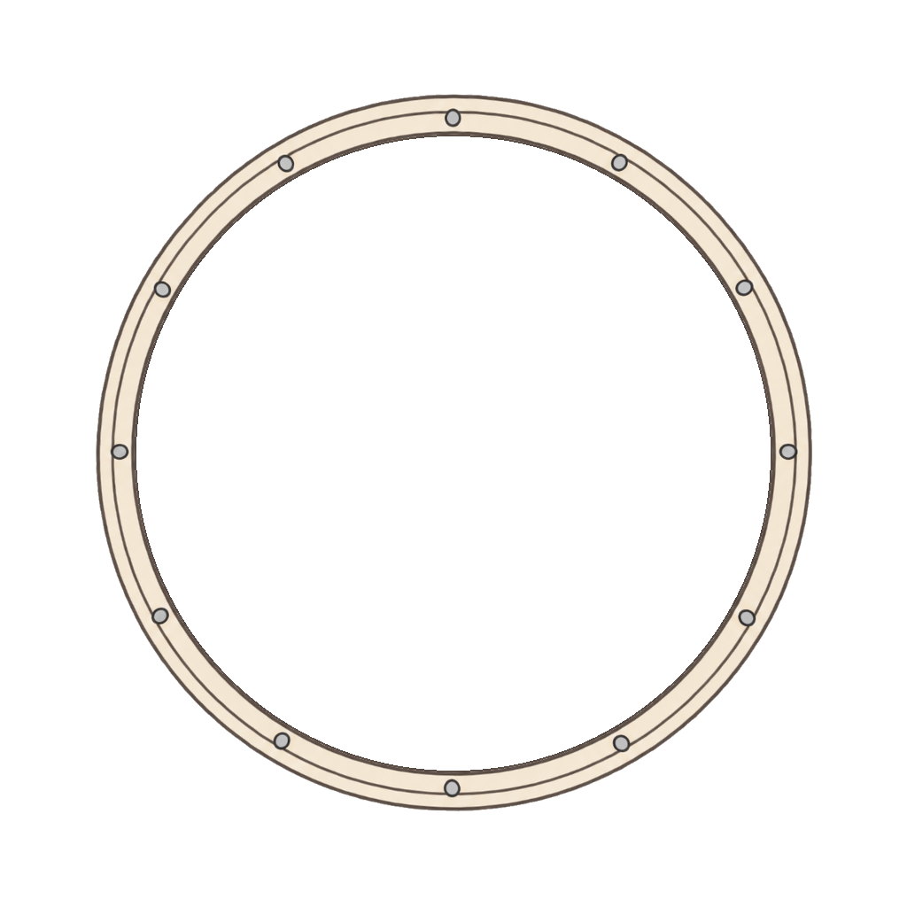

# 첫 GitHub 업로드 디자인 보정본

비교 기준은 **두 번째 수정본을 처음 업로드한 커밋 `844e7c29e9e0fa80ff2d8c9fc89322eb059e66bf`**입니다. [나란히 비교하기](index.html)에서 왼쪽은 그때의 실제 PNG, 오른쪽은 보정본을 표시합니다. 효과는 기본적으로 꺼져 있으며 버튼으로 켤 수 있습니다.

## 파일과 규격

- `normal/` 30종, `premium/` 25종, `rare/` 20종, `epic/` 15종, `legendary/` 10종: 투명 정지 PNG.
- `animations/epic/`: 그림 전체는 고정하고 후광·명암 이펙트의 투명도만 변화하는 SVG 15종.
- `animations/legendary/`: 테두리를 고정하고 원래 장식을 개별적으로 움직이는 SVG 10종.
- `layers/legendary/NNN/`: 전설에만 있는 테두리·장식 PNG와 `layers.json`.
- 최종 PNG·SVG는 1024×1024px, 중심 (512, 512), 안쪽 원 지름 716px. 중앙 알파는 0입니다.

그림을 원형 띠에 각도별로 눌러 넣던 변형을 피하고 기존 장식 비율을 복원했습니다. 출력에 남은 타원 투영은 그림 전체의 변환으로 보정하고 캔버스에는 균일 배율로 맞춥니다. 안쪽 2px 경계는 첫 업로드 PNG의 실제 픽셀을 보존합니다. 비율이 자연스러운 파일은 원본 바이트 그대로 유지합니다.

일반·고급·희귀·영웅에는 그림 레이어를 분리하지 않았습니다. 영웅 SVG는 완성 PNG 한 장과 별도의 이펙트만 포함합니다. 이펙트의 위치는 고정되고 3.84초 주기로 나타났다 사라집니다.

전설은 보정 PNG의 실제 픽셀을 테두리와 개별 장식으로 분리했습니다. 장식 뒤에 가려진 테두리는 같은 색과 선으로 별도 그린 `underpaint.png`를 사용해, 장식이 움직일 때 연결부가 비어 보이지 않도록 보완했습니다. 이 그림은 정지 자세에서 원래 불투명 장식에 완전히 가려지는 영역에만 적용합니다. 새 아이콘으로 대체하지 않았습니다. 원 안쪽의 고정 연결부는 남겨 두고 바깥 장식이 관절을 중심으로 움직입니다. 날개 접기·펼치기, 가지 흔들림, 수정 부유, 기계 톱니 동작 등을 7.68초 주기로 반복합니다. 테두리 전체는 회전하지 않으며 장식에 비균일 확대·축소를 적용하지 않습니다.

전설 레이어는 모두 같은 1024px 캔버스를 사용합니다. `layers.json`의 `origin`은 회전 중심입니다. 실제 SVG에서는 각 부품의 `fixed_mount_radius` 안쪽 연결부를 고정하고 바깥 부분만 움직입니다. 기본값은 410px이며, 윗날개는 386px, 작은 기어는 360px로 부품 모양에 맞춥니다. 이 마스크를 적용해 정지 상태의 레이어를 합치면 보정 PNG와 RGBA 값이 완전히 일치합니다.

## 사이트 적용

```html
<!-- 정지형 -->


<!-- 영웅: 이펙트 점멸 -->


<!-- 전설: 장식 개별 동작 -->

```

SVG 안에 PNG 레이어와 효과가 모두 포함돼 있어 다른 파일을 불러오지 않습니다. 운영체제의 동작 줄이기 설정에서는 애니메이션과 이펙트를 끕니다. 프로필 사진은 캔버스의 가로·세로 각각 69.921875% 크기로 중앙에 배치하면 안쪽 원에 맞습니다.

## 검증

`manifest.json`에는 기준 커밋·파일 해시·크기·레이어 분리 여부가 있습니다. `validation.json`에는 실제 Chromium에서 수행한 투명도, 안쪽 원, 정지 자세, 반복 동작, 128px 이펙트 가시성 검증 결과를 저장합니다.

기존 PNG와 이전 버전은 덮어쓰지 않았습니다. 압축 묶음 없이 개별 PNG·SVG로 저장합니다.
