# V2 — 비율을 보존한 새 프로필 테두리 100종

이번 수정본은 이 폴더입니다. 기존 `profile-borders`와 `profile-borders-animated`는 이전 버전으로 그대로 보존했습니다.
[실제 V2 파일 미리보기](index.html)에서 100종, 효과·동작, 개별 레이어를 확인할 수 있습니다.

| 등급 | 정지 PNG·SVG | 수량 | 효과·동작 SVG |
|---|---|---:|---|
| 일반 | [normal](normal) | 30 | 정지 |
| 고급 | [premium](premium) | 25 | 정지 |
| 희귀 | [rare](rare) | 20 | 정지 |
| 영웅 | [epic](epic) | 15 | [후광·명암 이펙트](animations/epic) |
| 전설 | [legendary](legendary) | 10 | [개별 장식 움직임과 이펙트](animations/legendary) |

## 눌린 형태 수정

원형 테두리와 장식을 분리해 새로 구성했습니다.
모든 장식은 새로 그린 독립 PNG이며, 배치할 때 가로·세로에 동일한 배율을 사용합니다.
방사형 압축·좌우 늘이기·상하 눌림 없이 꽃·보석·깃털의 원래 비율을 유지합니다.
움직임에도 회전·이동·동일 배율 확대축소만 사용하고, 비대칭 축소나 전단 변형을 사용하지 않습니다.

공통 규격은 1024×1024px, 중심 (512, 512), 실제 안쪽 원 지름 716px입니다.
중앙 원 내부는 알파값 0이며, 바깥에는 최소 16px의 안전 여백을 둡니다.

## 실제 개별 레이어

[layers](layers)에는 테두리 PNG 100개와 장식 PNG 300개가 있습니다.
각 디자인의 `layers.json`에는 원본 크기, 동일 배율, 위치, 연결점과 파일 경로가 기록돼 있습니다.

전설 예시:

```text
layers/legendary/097/
  frame.png            # 독립된 완전한 원형 테두리
  ornament_01.png      # 후광 왕관
  ornament_02.png      # 완전한 왼쪽 위 날개
  ornament_03.png      # 완전한 오른쪽 위 날개
  ornament_04.png      # 완전한 왼쪽 중간 날개
  ornament_05.png      # 완전한 오른쪽 중간 날개
  ornament_06.png      # 완전한 왼쪽 아래 날개
  ornament_07.png      # 완전한 오른쪽 아래 날개
  ornament_08.png      # 아래쪽 문장
  ornament_09.png      # 중앙 장식용 작은 보석
  layers.json
```

전설은 완성된 한 장을 잘라 움직이는 방식이 아닙니다.
테두리는 고정하고, 각 장식의 완전한 그림을 독립 레이어로 연결해 움직입니다.
날개는 연결점을 중심으로 접고 펼치며, 기어는 개별 축으로 작동하고, 파편·가지·용 마디는 테마에 맞게 움직입니다.

## 후광과 명암

영웅·전설의 **효과·동작 SVG**에는 색이 있는 부드러운 후광, 밝은 면과 어두운 면의 그라데이션, 얕은 그림자가 있습니다.
이펙트는 제자리에서 나타났다 사라집니다. 테두리 전체에는 과한 반사광을 넣지 않았습니다.
정지 PNG는 기본 테두리와 장식의 조립본이며, 후광·명암 이펙트와 동작은 `animations`의 SVG로 확인합니다.

SVG에는 모든 그림이 포함돼 있어 한 파일을 ``에 넣으면 재생됩니다.
기기의 `prefers-reduced-motion: reduce` 설정에서는 동작과 이펙트가 정지합니다.

```html
<div class="profile">
  
  
</div>
```

```css
.profile { position: relative; width: 128px; aspect-ratio: 1; }
.avatar {
  position: absolute; width: 69.921875%; height: 69.921875%;
  left: 15.0390625%; top: 15.0390625%; border-radius: 50%; object-fit: cover;
}
.frame { position: absolute; inset: 0; width: 100%; height: 100%; pointer-events: none; }
```

## 편집·재생성·검증

개별 PNG와 `layers.json`의 위치·배율·연결점을 편집한 뒤 저장소 루트에서 재생성할 수 있습니다.

```sh
python -m pip install -r tools/requirements.txt
python tools/build_profile_v2.py --from-layers
python tools/build_profile_v2_preview.py
```

실제 파일과 브라우저 렌더링 검사는 다음과 같습니다.

```sh
python -m pip install -r tools/browser-requirements.txt
python tools/validate_profile_v2.py --browser /usr/bin/chromium
```

[manifest.json](manifest.json)은 파일과 레이어 경로·SHA-256을,
[validation.json](validation.json)은 100종 PNG·300개 장식·25종 애니메이션의 검증 결과를 기록합니다.
모든 결과는 개별 파일이며 ZIP으로 묶지 않았습니다.
